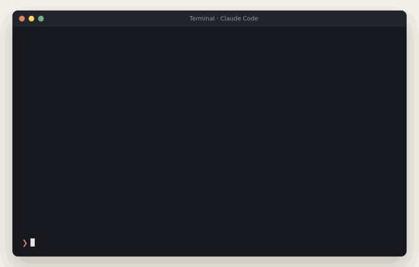
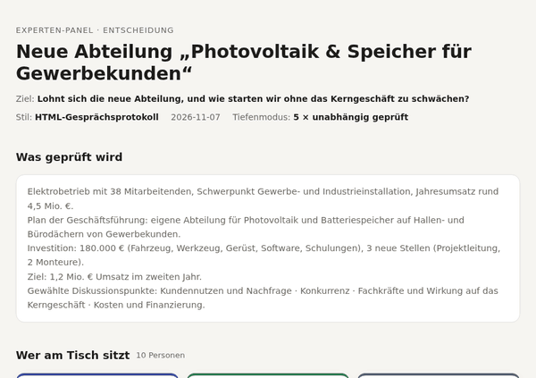
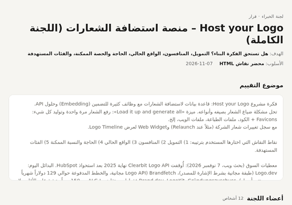
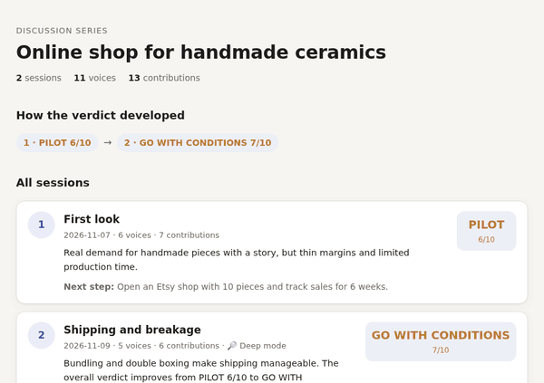
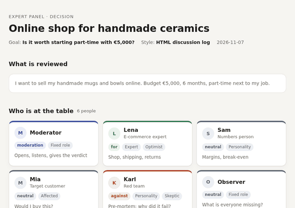
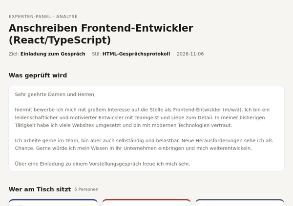
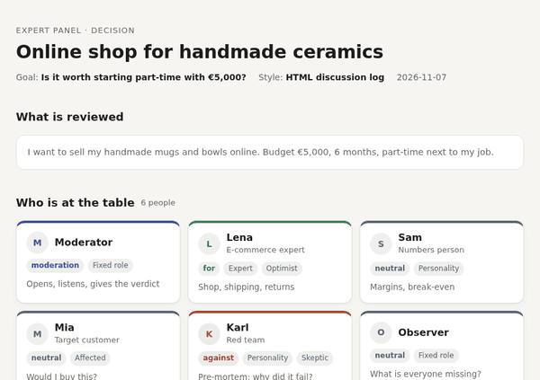

<div dir="rtl">

# multi-expert-panel

[English](README.md) · [Deutsch](README.de.md) · **العربية**

**مشورة خبراء لكل قرار في حياتك. اكتشف الثغرات والعيوب في مشروعك وأصلحها قبل أن تكلّفك.**

<p>


</p>

<p align="center"></p>
<p align="center"><sub>توضيح لسير العمل وليس تسجيلاً. صفحات النتائج الحقيقية في الأسفل.</sub></p>

أمامك فكرة أو خطة أو طلب وظيفة أو عقد أو شراء، وتريد أن تعرف رأي الخبير قبل أن تلتزم. هذه المهارة تُجلس لجنة كاملة حول الطاولة: بروفيسوراً وممارساً، مستثمراً وعميلاً حقيقياً، محامياً وجارك العادي. يتناقشون ويختلفون، ويتخيّل الفريق الأحمر لماذا فشل المشروع، ثم يعطيك مدير الجلسة حكماً واضحاً والخطوة التالية.

## ماذا تحصل عليه من جلسة واحدة

| | |
|---|---|
|  **حكم تستطيع العمل به** | موافقة · موافقة بشروط · تجربة مصغّرة · رفض، أو تقييم من 10، يُقاس دائماً بهدفك *أنت* |
|  **النقاط العمياء** | كل نقطة مرتّبة حسب خطورتها:  حرجة ·  متوسطة ·  بسيطة، مع أسماء الخبراء الذين طرحوها |
|  **تحسينات ملموسة** | صياغة قبل/بعد، أسطر برمجية مصحّحة، تجربة بمعيار نجاح، وليس «اكتب بدقة أكبر» |
|  **لماذا قد يفشل** | تحليل ما قبل الفشل من الفريق الأحمر: «مرّ 12 شهراً وفشل المشروع. لماذا؟» أرجح 3 أسباب |
|  **خطوة تالية واحدة** | الفعل الذي يكشف لك أكثر شيء، مثلاً «تجربة 6 أسابيع مع 10 وكالات، والنجاح = 3 عملاء يدفعون» |

## بالأرقام

| | |
|---|---|
|  **343** دوراً خبيراً في **25** فئة | من البروفيسور الباحث والطبيب الأخصائي ومهندس الإنشاءات إلى السبّاك وربّ الأسرة والمشتري لأول مرة |
|  **22** حزمة موضوع | قسم جديد في الشركة، تحسين منتج، فكرة مشروع، محل تجاري، موقع، شيفرة برمجية، سيرة ذاتية، رسالة تقديم، عقد، استثمار، قرار صحي، قرار حياتي، فعالية … |
|  **89** نقطة نقاش | التمويل، المنافسون، الطلب، الفئات المستهدفة، المخاطر … وكل نقطة مربوطة بالأدوار التي يجب أن تناقشها |
|  سلّم خبرة من **8** مستويات | البحث العلمي ← نخبة الممارسين ← الممارس المتخصص ← الخط الأول ← التنفيذ ← المتعلّم ← المتأثر ← الإنسان العادي |
|  **6** أساليب للنتيجة | تقرير اللجنة، مختصر، جلسة نقاش، فحص معمّق، مصفوفة، **محضر نقاش HTML** |
|  حتى **6** وكلاء مستقلين | في الوضع المعمّق يقيّم أهم الخبراء حالتك كلٌّ وحده، دون أن يعرف رأي الآخرين |
|  جلسات **بلا حد** | تعمّق في نقطة واحدة في كل جلسة، ولكل جلسة لجنتها الخاصة، وكلها في مجلد واحد |
|  **كل** اللغات | مدمجة: العربية (من اليمين لليسار) والإنجليزية والألمانية، ومُختبرة بالفرنسية أيضاً |
|  **7** حالات اختبار · اختبار تفعيل **18/18** | في `evals/` و`scripts/trigger_test.py` |

## لكل شيء تحتاج فيه رأي خبير

| أنت … | تسأل … | تكشف لك اللجنة مثلاً … |
|---|---|---|
| **أي شخص لديه خطة** | «هل أنتقل للعيش في الخارج / أشتري هذه السيارة / أبدأ هذه الدورة؟» | تكاليف نسيتها، رأي عائلتك، الخطة البديلة |
| **صاحب محل أو تاجر** | «هل يستحق فتح فرع ثانٍ / متجر إلكتروني؟» | الهامش الحقيقي، المنافسة المحلية، التراخيص، المواسم |
| **صاحب شركة** | «هل نطلق هذا المنتج / ندخل هذا السوق؟» | المنافسون، التسعير، التمويل، المخاطر القانونية، من يدفع فعلاً |
| **مؤسس مشروع ناشئ** | «قيّم فكرة مشروعي» | الطلب، حجم السوق، البدائل المجانية، شروط الدعم |
| **متقدّم لوظيفة** | «حلّل رسالة التقديم / سيرتي الذاتية» | معلومات إلزامية ناقصة، عبارات فارغة، ما يراه مسؤول التوظيف في 30 ثانية |
| **مستقل أو وكالة** | «راجع هذا العرض / الموقع / الشيفرة» | نقاط الضعف قبل أن يكتشفها العميل |
| **طالب أو باحث** | «افحص حجّتي / مخطط رسالتي» | الثغرات المنطقية، الأدلة الناقصة، كيف سيردّ المحكّم |
| **مريض أو قريب مريض** | «ساعدني أستعد لقرار هذا العلاج» | الأسئلة التي تطرحها على الطبيب، ونقاط لرأي طبي ثانٍ |

اللجنة لا تغني عن محامٍ أو طبيب أو مستشار ضرائب حقيقي، لكنها تساعدك أن تذهب إليهم بالأسئلة الصحيحة.

## أمثلة

### 1 · شركة: إضافة قسم جديد «الطاقة الشمسية والتخزين لعملاء الشركات» ←  موافقة بشروط 6/10

```
/multi-expert-panel Evaluiere gründlich: neue Abteilung PV & Speicher für Gewerbekunden – 38 MA, Invest 180.000 €
```

**الوضع:** شركة أعمال كهربائية فيها 38 موظفاً وإيراداتها 4.5 مليون يورو، تريد استثمار 180 ألف يورو وتوظيف 3 أشخاص جدد، والهدف 1.2 مليون يورو إيرادات في السنة الثانية.
**اللجنة:** 10 أصوات، منها **5 كوكلاء مستقلين** (خبير مخضرم في القطاع، مراقبة مالية، عميل مستهدف من شركة شحن، محلل منافسين، الفريق الأحمر)، ومعهم مدير المبيعات ورئيس الفنيين في النشاط الأساسي ومستشارة تمويل · **4 جولات · 21 مداخلة** (بالألمانية)

**ما كشفته:**
-  لا يوجد مدير مشاريع بعد: سيُسحب أفضل الفنيين من النشاط الأساسي الذي لديه أصلاً طلبات متأخرة 6 أسابيع.
-  لا توجد منشأة مرجعية: عملاء الشركات لا يشترون أنظمة بمئات الآلاف دون دليل.
-  خسارة سنة البداية غير مموّلة، والقرض المدعوم يجب طلبه *قبل* الشراء.
-  الشركات الكبرى بعقود التأجير تربح الأسطح الضخمة، فالأفضل حصر العرض في 100–500 kWp.
-  لم ينتبه له أحد إلا المراقب: عقود الصيانة تجلب إيراداً متكرراً كل سنة.

**قبل ← بعد:** «قسم كامل بـ 3 وظائف و180 ألف يورو دفعة واحدة» ← «تجربة 6 أشهر مع فنيَّين مؤهَّلين و3 منشآت لدى عملاء دائمين».

<p align="center"></p>

وبالطريقة نفسها: **تحسين منتج** («قيّم: إضافة بحث ذكي إلى متجرنا»)، **خدمة جديدة**، **فرع ثانٍ**، **رفع الأسعار** أو **مشروع داخلي**، ولها حزم مواضيع خاصة ([company-expansion](skills/multi-expert-panel/library/topics/company-expansion.md)، [product-improvement](skills/multi-expert-panel/library/topics/product-improvement.md)).

### 2 · فكرة مشروع: منصة استضافة الشعارات Host your Logo ←  تجربة مصغّرة 5/10

```
/multi-expert-panel قيّم بعمق: فكرة Host your Logo – منصة استضافة الشعارات مع API وسجل تغييرات
```

**اللجنة:** 12 صوتاً، منهم خبير مخضرم في سوق Brand/DAM، ومدير منتج لدى منافس يقدّم Logo API، ومحامية قانون تقنية المعلومات، ومستشار تمويل، والفريق الأحمر · **6 جولات · 38 مداخلة**، على نقاط النقاش الخمس التي اختارها المستخدم (التمويل، المنافسون، الواقع الحالي، الحاجة، الفئات المستهدفة).

**ما كشفته:** بدون تحقق من ملكية الشعار تصبح المنصة أداة لصفحات التصيّد · الحاجة تحدث مرة لكل عميل، والاشتراك الشهري يحتاج سبباً دائماً غير مُثبت · واجهات Logo API المجانية موجودة أصلاً.
**الخطوة التالية:** تجربة 6 أسابيع مع 10 وكالات و5 منظمي فعاليات، والنجاح = 3 عملاء يدفعون.

<p align="center"></p>

### 3 · تعمّق أكثر: سلسلة جلسات ← تجربة مصغّرة 6/10 تصبح موافقة بشروط 7/10

```
/multi-expert-panel جلسة جديدة: الشحن والكسر
```

تبدأ الجلسة الثانية بما وجدته الجلسة الأولى، وتضيف خبيراً في الشحن، وتناقش هذه النقطة وحدها بعمق. كل الجلسات تُحفظ في مجلد واحد، مع صفحة رئيسية تُظهر كيف تطوّر الحكم.

<p align="center"></p>

### 4 · فكرة متجر إلكتروني للخزف اليدوي ←  تجربة مصغّرة 6/10

**اللجنة:** 6 أصوات (خبيرة تجارة إلكترونية، رجل الأرقام، العميلة المستهدفة، الفريق الأحمر، المراقب، مديرة الجلسة) · **جولتان**

**ما كشفته:** القدرة الإنتاجية وفرن الحرق في البيت غير واضحين · الشحن والكسر قد يأكلان الهامش · المتجر الخاص مبكر جداً، الأسواق الجاهزة مثل Etsy أولاً.

<p align="center"></p>

### 5 · رسالة تقديم لوظيفة ← 3/10 مع صياغات جاهزة

**اللجنة:** مسؤولة التوظيف، مدير القسم، القارئ المستعجل، مرشد مهني، مدير الجلسة · **3 جولات · 13 مداخلة**

**ما كشفته:** الراتب المتوقع وتاريخ البدء ناقصان رغم أن الإعلان يطلبهما · React وTypeScript وسنوات الخبرة غير مذكورة · لا يوجد مشروع ملموس كدليل. ولكل تحسين جملة قبل/بعد.

<p align="center"></p>

### 6 · بكل اللغات

<p align="center"></p>

## كيف تعمل

1. **تصف حالتك**: نص أو ملف أو فكرة أو سؤال، ويُفضّل مع الهدف والميزانية والمدة. اكتب «قيّم:» للأفكار والخطط، و«حلّل:» للنصوص والشيفرة والمستندات.
2. **تُقترح اللجنة** من [المكتبة](skills/multi-expert-panel/library/README.md): حزمة الموضوع المناسبة تقترح 3 خبراء موصى بهم، مع وجهات نظر من فئات أخرى (مستويات فريق العمل، أنماط الشخصية، المتأثرون، الباحثون). تختار أنت أو تحذف أو تضيف من تريد.
3. **تحدد أنت نقاط النقاش**: نقاطك الخاصة، أو 4–6 نقاط مقترحة تناسب حالتك.
4. **تختار الأسلوب**: من جواب مختصر في شاشة واحدة إلى محضر نقاش HTML كامل.
5. **تتناقش اللجنة.** لكل صوت موقف (مؤيد، معارض، محايد)، فتظهر حجج مضادة حقيقية. أدوار البحث تبحث في الإنترنت وتذكر مصادرها.
6. **يحكم مدير الجلسة**: تقييم واحد أو حكم واحد، نقاط مرتّبة حسب الخطورة، تحسينات ملموسة، والخطوة التالية. أي مشكلة حرجة مفتوحة تحدّ التقييم عند 6 من 10، حتى لا تختفي مشكلة خطيرة خلف تفاصيل جيدة كثيرة.

**الوضع المعمّق** (اكتب «معمّق» أو «بعمق»): حتى 6 من أهم الخبراء يقيّمون حالتك كوكلاء منفصلين يعملون بالتوازي. لا يعرف أحدهم رأي الآخرين، وكل واحد يبحث بنفسه، ثم يدير مدير الجلسة النقاش بهذه المواقف الحقيقية. هكذا تحصل على أصوات معارضة صادقة بدل نموذج واحد يتفق مع نفسه. وإذا لم تدعم البيئة الوكلاء، تعمل المهارة بالوضع العادي. التفاصيل: [references/subagent-modus.md](skills/multi-expert-panel/references/subagent-modus.md).

**سلسلة الجلسات** (اكتب «جلسة جديدة» أو «تعمّق في …»): تُحفظ كل جلسة كصفحة HTML في المجلد `panel_<الاسم>/`، ومعها `index.html` (كل الجلسات وتطوّر الحكم) و`dossier.md` (القرارات، الأسئلة المفتوحة، الحقائق ومصادرها). كل جلسة جديدة تقرأ هذا الملف، وتحصل على لجنة خاصة بموضوعها، ولا تعيد نقاش ما حُسم. التفاصيل: [references/serie.md](skills/multi-expert-panel/references/serie.md).

التعليمات الكاملة في [SKILL.md](skills/multi-expert-panel/SKILL.md) (مكتوبة بالألمانية، واللجنة تجيب بلغتك).

## التثبيت

| تستخدم … | الطريقة |
|---|---|
| **Claude Code** | `/plugin marketplace add yalbarzawi/multi-expert-panel` ثم `/plugin install multi-expert-panel@multi-expert-panel`. التحديثات تصل مع كل إصدار جديد. |
| **claude.ai** (Pro وMax وTeam وEnterprise) | نزّل `multi-expert-panel.zip` من [آخر إصدار](https://github.com/yalbarzawi/multi-expert-panel/releases/latest)، فعّل *تنفيذ الشيفرة وإنشاء الملفات*، ثم ارفع الملف من *الإعدادات ← Skills*. |
| **يدوياً** (Claude Code ووكلاء آخرون) | `git clone https://github.com/yalbarzawi/multi-expert-panel.git ~/multi-expert-panel` ثم `ln -s ~/multi-expert-panel/skills/multi-expert-panel ~/.claude/skills/multi-expert-panel` |
| **مساعدات أخرى** (ChatGPT، Lumo، …) | الصق محتوى `skills/multi-expert-panel/SKILL.md` بدون الـ frontmatter كتعليمات نظام. |

بعدها اكتب `/multi-expert-panel` أو ببساطة «قيّم: …» أو «ما الذي لم أنتبه له؟».

### ما الذي يعمل أين

| | Claude Code | claude.ai | مساعدات أخرى |
|---|---|---|---|
| أساليب المحادثة A–E |  |  |  |
| محضر نقاش HTML (F) |  |  مع تنفيذ الشيفرة | نسخ القالب يدوياً |
| الوضع المعمّق (وكلاء مستقلون) |  | يعود للوضع العادي | يعود للوضع العادي |
| سلسلة الجلسات مع مجلد وملف ذاكرة |  | داخل محادثة واحدة | داخل محادثة واحدة |

### التحديثات

| طريقة التثبيت | كيف تصلك التحديثات |
|---|---|
| إضافة Claude Code | تلقائياً مع كل إصدار جديد (أو `/plugin marketplace update multi-expert-panel`) |
| ملف ZIP في claude.ai | نزّل الملف الجديد من [Releases](https://github.com/yalbarzawi/multi-expert-panel/releases) وارفعه من جديد. للإشعار: على GitHub اختر **Watch ← Custom ← Releases** |
| نسخة يدوية | `git -C ~/multi-expert-panel pull` |

ما الذي تغيّر في كل إصدار: [CHANGELOG.md](CHANGELOG.md).

**التكلفة:** الوضع المعمّق يشغّل حتى 6 وكلاء. في اختبار فعلي استهلك 5 وكلاء مع البحث في الإنترنت حوالي 250 ألف رمز معاً، واستغرقوا دقيقة ونصفاً تقريباً. لا يبدأ إلا إذا طلبته.
**الخصوصية:** المهارة لا ترسل شيئاً من نفسها. محاضر HTML ملفات محلية قد تحتوي ما أرسلته (سيرة ذاتية، عقد، أرقام)، فراجعها قبل مشاركتها. راجع [SECURITY.md](SECURITY.md).

## أمثلة أخرى للطلبات

```
قيّم: فكرة مطعم صغير في المدينة – الميزانية: 30 ألف يورو
```

```
قيّم بعمق: هل أترك وظيفتي وأعمل مصمم UX مستقلاً؟
```

```
حلّل: [نص الرسالة] – الهدف: دعوة لمقابلة عمل
```

## للمساهمين

- راجع [CONTRIBUTING.md](CONTRIBUTING.md). كل طلب مساهمة يحصل على رد خلال 7 أيام.

- المكتبة هي وقود اللجنة وتتوسع باستمرار: أضف أدواراً أو حزم مواضيع أو حقائق مؤرّخة، ثم شغّل `python3 skills/multi-expert-panel/scripts/check_library.py`. راجع [library/README.md](skills/multi-expert-panel/library/README.md).
- لإعادة توليد الصور المتحركة بعد التعديل: `python3 scripts/make_demo_gifs.py` (صفحات النتائج واللغات والسلسلة) و`python3 scripts/make_flow_gifs.py` (سير العمل في الطرفية، ومحتواه في `demo/flow.json`). كلاهما يحتاج Chrome/Chromium وffmpeg وPillow.

## المطوّر

من تطوير **Yahia Albarzawi**، مطوّر ويب ومصمم وسائط. [GitHub](https://github.com/yalbarzawi)

## الترخيص

MIT، راجع [LICENSE](LICENSE).

</div>
