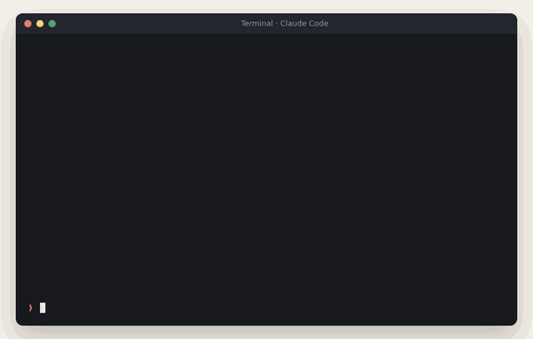
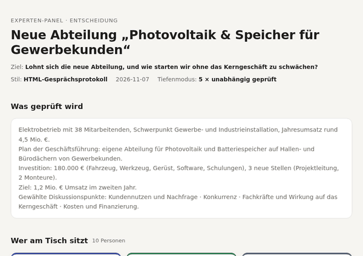
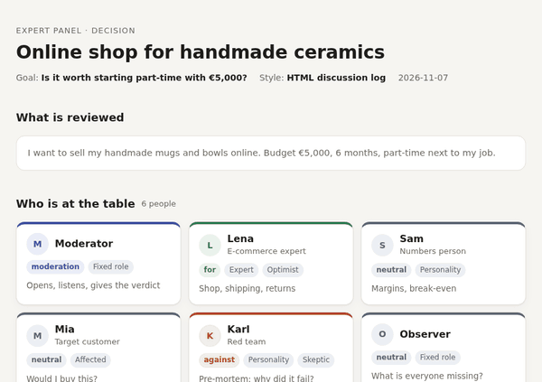
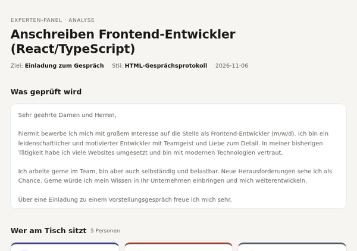
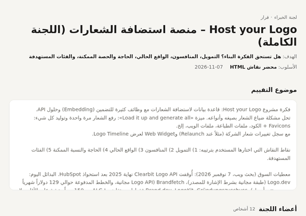
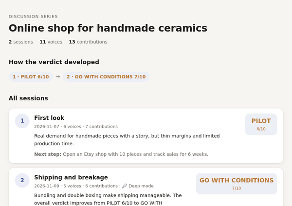
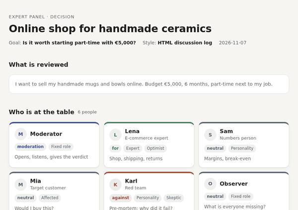

# multi-expert-panel

[English](README.md) · **Deutsch** · [العربية](README.ar.md)

**Expertenrat für jede Entscheidung im Leben. Finde die Lücken und Schwächen in deinem Vorhaben und behebe sie, bevor sie dich etwas kosten.**

<p>


</p>

<p align="center"></p>
<p align="center"><sub>Illustration des Ablaufs, keine Aufnahme. Echte Ergebnisseiten unten.</sub></p>

Du hast eine Idee, einen Plan, eine Bewerbung, einen Vertrag oder eine Anschaffung vor dir und willst wissen, was ein Fachmann dazu sagen würde, bevor du dich festlegst. Dieser Skill setzt ein ganzes Panel an den Tisch: eine Professorin und einen Praktiker, einen Investor und eine echte Kundin, eine Anwältin und deinen Nachbarn. Sie streiten, ein Red Team stellt sich vor, warum es gescheitert ist, und ein Moderator gibt dir ein Urteil und den nächsten Schritt.

## Was du nach einem Durchlauf hast

| | |
|---|---|
|  **Ein Urteil, mit dem du handeln kannst** | GO · GO MIT AUFLAGEN · PILOT · NO-GO oder eine Note von 10, immer gemessen an *deinem* Ziel |
|  **Die blinden Flecken** | jeder Punkt gewichtet:  kritisch ·  mittel ·  klein, mit den Experten, die ihn genannt haben |
|  **Konkrete Verbesserungen** | Vorher/Nachher-Formulierungen, korrigierte Codezeilen, ein Test mit Erfolgskriterium, kein „präziser formulieren“ |
|  **Woran es scheitern könnte** | ein Pre-Mortem des Red Teams: „12 Monate später ist es gescheitert. Warum?“ Die 3 wahrscheinlichsten Gründe |
|  **Ein nächster Schritt** | die eine Handlung, die dir am meisten verrät, z. B. „die 3 Stammkunden mit dem höchsten Tagverbrauch für eine Ertragsanalyse ansprechen“ |

## In Zahlen

| | |
|---|---|
|  **343** Expertenrollen in **25** Kategorien | von Forschungsprofessorin, Fachärztin und Statiker bis Installateur, Elternteil und Erstkäufer |
|  **22** Themenpakete | neue Abteilung, Produktverbesserung, Geschäftsidee, lokales Geschäft, Website, Code, Lebenslauf, Anschreiben, Vertrag, Geldanlage, Gesundheitsentscheidung, Lebensentscheidung, Veranstaltung … |
|  **89** Diskussionspunkte | Finanzierung, Konkurrenz, Nachfrage, Zielgruppen, Risiken … jeweils mit den Rollen, die darüber sprechen sollten |
|  **8** Stufen der Expertise-Leiter | Forschung → Spitzenpraxis → Fachpraxis → Grundversorgung → Ausführung → Lernend → Betroffen → Laie |
|  **6** Ausgabestile | Panel-Bericht, Kompakt, Gesprächsrunde, Tiefenprüfung, Matrix, **HTML-Gesprächsprotokoll** |
|  bis zu **6** unabhängige Agenten | im Tiefenmodus prüfen die wichtigsten Experten getrennt, ohne die Meinung der anderen zu kennen |
|  **beliebig viele** Sitzungen | pro Sitzung einen Punkt vertiefen, jede mit eigenem Panel, alles in einem Ordner |
|  **jede** Sprache | eingebaut Deutsch, Englisch, Arabisch (rechts nach links); auch auf Französisch getestet |
|  **7** Testfälle · Auslöse-Test **18/18** | in `evals/` und `scripts/trigger_test.py` |

## Für alles, wozu du einen Fachmann fragen würdest

| Du bist … | Du fragst … | Das Panel zeigt dir zum Beispiel … |
|---|---|---|
| **Jemand mit einem Plan** | „Soll ich ins Ausland ziehen / dieses Auto kaufen / diesen Kurs machen?“ | vergessene Kosten, was deine Familie davon hält, Plan B |
| **Ladeninhaber oder Händler** | „Lohnt sich ein zweiter Laden / ein Onlineshop?“ | echte Margen, Konkurrenz vor Ort, Genehmigungen, Saison |
| **Unternehmer** | „Sollen wir dieses Produkt starten / diesen Markt betreten?“ | Wettbewerber, Preise, Finanzierung, rechtliche Risiken, wer wirklich zahlt |
| **Gründerin** | „Evaluiere meine Startup-Idee“ | Nachfrage, Marktgröße, kostenlose Alternativen, Förderbedingungen |
| **Bewerber** | „Analysiere mein Anschreiben / meinen Lebenslauf“ | fehlende Pflichtangaben, leere Floskeln, was der Recruiter in 30 Sekunden sieht |
| **Freelancer oder Agentur** | „Prüf dieses Angebot / diese Website / diesen Code“ | Schwachstellen, bevor der Kunde sie findet |
| **Studentin oder Forscher** | „Prüf meine Argumentation / Gliederung“ | logische Lücken, fehlende Belege, wie ein Gutachter reagieren würde |
| **Patient oder Angehörige** | „Hilf mir, mich auf diese Behandlungsentscheidung vorzubereiten“ | die Fragen an die Ärztin, Punkte für eine Zweitmeinung |

Das Panel ersetzt keine echte Anwältin, keinen Arzt und keine Steuerberaterin. Es hilft dir, mit den richtigen Fragen zu ihnen zu gehen.

## Beispiele

### 1 · Unternehmen: neue Abteilung „Photovoltaik & Speicher für Gewerbekunden“ →  GO MIT AUFLAGEN 6/10

```
/multi-expert-panel Evaluiere gründlich: neue Abteilung PV & Speicher für Gewerbekunden – 38 MA, Invest 180.000 €
```

**Ausgangslage:** Elektrobetrieb mit 38 Mitarbeitenden und 4,5 Mio. € Umsatz, 180.000 € Investition, 3 neue Stellen, Ziel 1,2 Mio. € Umsatz im zweiten Jahr.
**Panel:** 10 Stimmen, davon **5 als unabhängige Agenten** (Branchenveteran, Controllerin, Zielkunde Spedition, Wettbewerbsanalyst, Red Team), dazu Vertriebsleiter, Obermonteur aus dem Kerngeschäft, Fördermittelberaterin · **4 Runden · 21 Beiträge**

**Gefunden:**
-  Projektleitung nicht besetzt: Ohne sie werden die besten Monteure aus dem Kerngeschäft abgezogen, bei schon 6 Wochen Vorlauf.
-  Keine Referenzanlage: Gewerbekunden kaufen sechsstellige Anlagen nur mit Nachweis.
-  Ein Jahr Anlaufverlust ist nicht finanziert, Förderdarlehen muss *vor* dem Kauf beantragt werden.
-  Projektierer mit Pachtmodellen schlagen jedes Angebot bei sehr großen Dächern, also Angebot auf 100–500 kWp begrenzen.
-  Übersehen von allen außer dem Beobachter: Wartungsverträge bringen jedes Jahr wiederkehrenden Umsatz.

**Vorher → nachher:** „Abteilung mit 3 Stellen und 180.000 € auf einmal“ → „6 Monate Pilot mit 2 qualifizierten Gesellen und 3 Anlagen bei Stammkunden“.
**Nächster Schritt:** 15 Bestandskunden mit bekanntem Dach und Verbrauch auflisten, die 3 mit dem höchsten Tagverbrauch für eine Ertragsanalyse ansprechen.

<p align="center"></p>

Genauso für **Produktverbesserungen** („Evaluiere: KI-Suche in unserem Shop einbauen“), **neue Dienstleistungen**, **zweiten Standort**, **Preiserhöhung** oder **internes Projekt**: Es gibt eigene Themenpakete dafür ([company-expansion](skills/multi-expert-panel/library/topics/company-expansion.md), [product-improvement](skills/multi-expert-panel/library/topics/product-improvement.md)).

### 2 · Geschäftsidee: Onlineshop für handgemachte Keramik →  PILOT 6/10

```
/multi-expert-panel Evaluiere: Onlineshop für handgemachte Keramik, Budget 5.000 €, nebenberuflich
```

**Panel:** 6 Stimmen (E-Commerce-Expertin, Zahlenmensch, Zielkundin, Red Team, Beobachter, Moderatorin) · **2 Runden**

**Gefunden:** Produktionskapazität und Brennofen zu Hause sind ungeklärt · Versand und Bruch können die Marge auffressen · eigener Shop zu früh, erst Marktplätze.
**Nächster Schritt:** Etsy-Shop mit 10 Stücken, 6 Wochen die Verkäufe beobachten.

<p align="center"></p>

### 3 · Bewerbung: Anschreiben → Note 3/10 mit fertigen Formulierungen

```
/multi-expert-panel Analysiere: anschreiben.md – Ziel: Einladung, Kontext: stellenanzeige.pdf
```

**Panel:** HR-Personalerin, Hiring Manager, ungeduldiger Leser, Karriere-Mentor, Moderator · **3 Runden · 13 Beiträge**

**Gefunden:** Gehaltsvorstellung und Eintrittstermin fehlen, obwohl die Anzeige sie verlangt · React, TypeScript und Berufsjahre werden nicht genannt · kein konkretes Projekt als Beleg.
**Verbesserungen:** 3 Vorschläge, jeder mit Vorher/Nachher-Satz.

<p align="center"></p>

### 4 · Startup-Idee auf Arabisch: Logo-Hosting-Plattform →  PILOT 5/10

**Panel:** 12 Stimmen, darunter ein Brand/DAM-Veteran, der Produktmanager einer konkurrierenden Logo-API, eine IT-Rechtlerin, ein Fördermittelberater und ein Red Team · **6 Runden · 38 Beiträge** entlang der 5 Punkte, die der Nutzer gewählt hat (Finanzierung, Konkurrenz, Ist-Zustand, Bedarf, Zielgruppen).

**Gefunden:** Ohne Prüfung der Logo-Inhaberschaft wird die Plattform zum Werkzeug für Phishing · der Bedarf entsteht einmal pro Kunde, ein Monatsabo braucht einen Grund, der nicht belegt ist · kostenlose Logo-APIs gibt es schon.
**Nächster Schritt:** 6-Wochen-Pilot mit 10 Agenturen und 5 Veranstaltern; Erfolg = 3 zahlende Kunden.

<p align="center"></p>

### 5 · Tiefer gehen: eine Gesprächsreihe → aus PILOT 6/10 wird GO MIT AUFLAGEN 7/10

```
/multi-expert-panel Nächste Sitzung: Versand und Bruch
```

Sitzung 2 beginnt mit dem, was Sitzung 1 herausgefunden hat, holt einen Logistik-Spezialisten dazu und bespricht nur diesen einen Punkt in der Tiefe. Alle Sitzungen liegen in einem Ordner mit einer Übersicht, die zeigt, wie sich das Urteil entwickelt hat.

<p align="center"></p>

### 6 · Jede Sprache

<p align="center"></p>

## So funktioniert es

1. **Du beschreibst deinen Fall**: Text, Datei, Idee oder Frage, gern mit Ziel, Budget und Zeitrahmen. „Evaluiere:“ für Ideen und Pläne, „Analysiere:“ für Texte, Code und Dokumente.
2. **Das Panel wird vorgeschlagen**, aus der [Bibliothek](skills/multi-expert-panel/library/README.md): Das passende Themenpaket liefert 3 empfohlene Experten und Perspektiven aus anderen Kategorien (Team-Hierarchie, Persönlichkeitstypen, Betroffene, Recherche). Du wählst, streichst oder nennst eigene.
3. **Du bestimmst die Agenda**: eigene Diskussionspunkte oder 4–6 vorgeschlagene, passend zu deinem Fall.
4. **Du wählst den Stil**: von der kompakten Antwort auf einem Bildschirm bis zum vollständigen HTML-Gesprächsprotokoll.
5. **Das Panel diskutiert.** Jede Stimme hat eine Seite (dafür, dagegen, neutral), so entstehen echte Gegenargumente. Recherche-Rollen suchen im Web und nennen Quellen.
6. **Der Moderator entscheidet**: eine Note bzw. ein Urteil, gewichtete Kritikpunkte, konkrete Verbesserungen, nächster Schritt. Ein offener kritischer Punkt begrenzt die Note auf 6/10, damit ein ernstes Problem nicht unter vielen guten Details verschwindet.

**Tiefenmodus** („gründlich“ oder „tief“): Bis zu 6 wichtige Experten prüfen deinen Fall als eigene Subagents parallel. Keiner kennt die Meinung der anderen, jeder recherchiert selbst, und der Moderator führt danach das Gespräch mit diesen echten Positionen. So bekommst du ehrliche Gegenstimmen statt eines Modells, das mit sich selbst einig ist. Ohne Agent-Unterstützung läuft der Skill einfach im normalen Modus. Details: [references/subagent-modus.md](skills/multi-expert-panel/references/subagent-modus.md).

**Gesprächsreihe** („nächste Sitzung“ oder „vertiefe …“): Jede Sitzung wird als HTML-Seite in `panel_<name>/` gespeichert, dazu `index.html` (alle Sitzungen und der Verlauf des Urteils) und `dossier.md` (Entscheidungen, offene Fragen, Fakten mit Quellen). Jede neue Sitzung liest das Dossier, bekommt ein eigenes Panel für ihr Thema und wiederholt nichts, was geklärt ist. Details: [references/serie.md](skills/multi-expert-panel/references/serie.md).

Die vollständige Anleitung steht in [SKILL.md](skills/multi-expert-panel/SKILL.md).

## Installation

| Du nutzt … | So geht's |
|---|---|
| **Claude Code** | `/plugin marketplace add yalbarzawi/multi-expert-panel`, dann `/plugin install multi-expert-panel@multi-expert-panel`. Updates kommen mit jeder neuen Version. |
| **claude.ai** (Pro, Max, Team, Enterprise) | `multi-expert-panel.zip` aus dem [neuesten Release](https://github.com/yalbarzawi/multi-expert-panel/releases/latest) laden, *Code-Ausführung und Dateierstellung* einschalten, ZIP unter *Einstellungen → Skills* hochladen. |
| **Manuell** (Claude Code, andere Agenten) | `git clone https://github.com/yalbarzawi/multi-expert-panel.git ~/multi-expert-panel` und `ln -s ~/multi-expert-panel/skills/multi-expert-panel ~/.claude/skills/multi-expert-panel` |
| **Andere Assistenten** (ChatGPT, Lumo, …) | Inhalt von `skills/multi-expert-panel/SKILL.md` ohne Frontmatter als Systemanweisung einfügen. |

Dann `/multi-expert-panel` eingeben oder einfach „Evaluiere: …“ / „Was übersehe ich?“ schreiben.

### Was läuft wo

| | Claude Code | claude.ai | Andere Assistenten |
|---|---|---|---|
| Chat-Stile A–E |  |  |  |
| HTML-Gesprächsprotokoll (F) |  |  mit Code-Ausführung | Vorlage von Hand kopieren |
| Tiefenmodus (unabhängige Agenten) |  | fällt auf normalen Modus zurück | fällt auf normalen Modus zurück |
| Gesprächsreihe mit Ordner und Dossier |  | innerhalb eines Chats | innerhalb eines Chats |

### Updates

| Installiert über | So kommen Updates |
|---|---|
| Claude-Code-Plugin | automatisch mit jeder neuen Version (oder `/plugin marketplace update multi-expert-panel`) |
| claude.ai-ZIP | neues ZIP unter [Releases](https://github.com/yalbarzawi/multi-expert-panel/releases) laden und erneut hochladen. Benachrichtigung: auf GitHub **Watch → Custom → Releases** |
| Manueller Clone | `git -C ~/multi-expert-panel pull` |

Was sich in jeder Version geändert hat: [CHANGELOG.md](CHANGELOG.md).

**Kosten:** Der Tiefenmodus startet bis zu 6 Agenten. Gemessen im Testlauf: 5 Agenten mit Websuche brauchten zusammen etwa 250.000 Tokens und etwa 1,5 Minuten. Er startet nur, wenn du ihn verlangst.
**Datenschutz:** Der Skill sendet von sich aus nichts. HTML-Protokolle sind lokale Dateien und können enthalten, was du eingereicht hast (Lebenslauf, Vertrag, Zahlen). Vor dem Teilen prüfen. Siehe [SECURITY.md](SECURITY.md).

## Weitere Aufrufe

```
Evaluiere: Café in einer Kleinstadt eröffnen – Budget: 80k – Stil: Gesprächsrunde
```

```
Evaluiere gründlich: Soll ich kündigen und mich als UX-Designerin selbstständig machen?
```

```
Analysiere: login.php – Panel: Security-Auditor, Junior, CTO – Stil: Tiefenprüfung
```

```
Analysiere, nur der Kritiker: [Text]
```

## Mitmachen

- Siehe [CONTRIBUTING.md](CONTRIBUTING.md). Jeder Pull Request bekommt innerhalb von 7 Tagen eine Antwort.

- Die Bibliothek ist der Treibstoff des Panels und wächst ständig: Rollen, Themenpakete oder datierte Fakten ergänzen, dann `python3 skills/multi-expert-panel/scripts/check_library.py` ausführen. Siehe [library/README.md](skills/multi-expert-panel/library/README.md).
- GIFs nach Änderungen neu erzeugen: `python3 scripts/make_demo_gifs.py` (Ergebnisseiten, Sprachen, Reihe) und `python3 scripts/make_flow_gifs.py` (Ablauf im Terminal; Inhalte in `demo/flow.json`). Beide brauchen Chrome/Chromium, ffmpeg und Pillow.

## Entwickler

Entwickelt von **Yahia Albarzawi**, Webentwickler und Mediengestalter. [GitHub](https://github.com/yalbarzawi)

## Lizenz

MIT, siehe [LICENSE](LICENSE).
