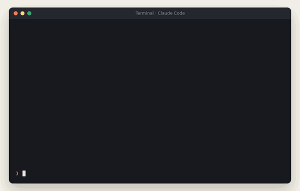
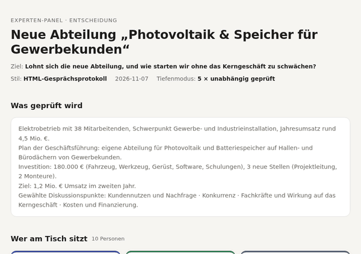
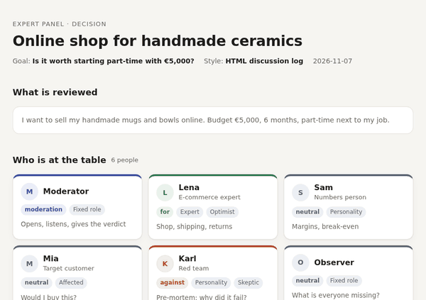
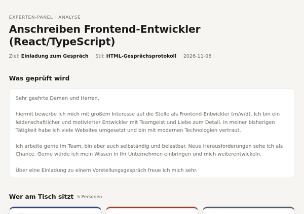
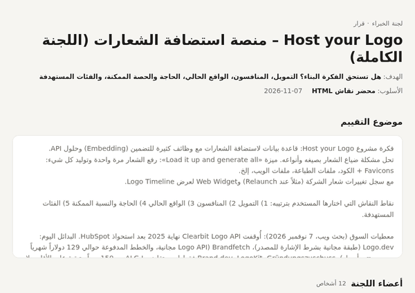
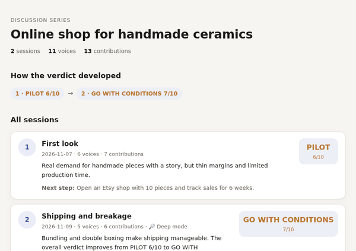
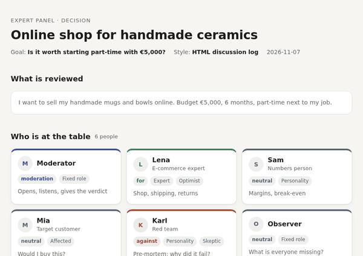

# multi-expert-panel

**English** · [Deutsch](README.de.md) · [العربية](README.ar.md)

**Expert advice for any decision in your life. Find the gaps and flaws in your plan, and fix them before they cost you.**

<p>


</p>

<p align="center"></p>
<p align="center"><sub>Illustration of the flow, not a recording. Real result pages below.</sub></p>

You have an idea, a plan, an application, a contract or a purchase in front of you, and you want to know what an expert would say before you commit. This skill sits a whole panel at the table: a professor and a practitioner, an investor and a real customer, a lawyer and your neighbour. They argue, a red team imagines why it failed, and a moderator gives you a verdict and the next step.

## What you get from one run

|                                     |                                                                                                         |
| ----------------------------------- | ------------------------------------------------------------------------------------------------------- |
|  **A verdict you can act on** | GO · GO WITH CONDITIONS · PILOT · NO-GO, or a score out of 10, always measured against *your* goal |
|  **The blind spots**          | every issue ranked  critical ·  medium ·  minor, with the experts who raised it                       |
|  **Concrete fixes**           | before/after rewrites, corrected code lines, a test with a success criterion, not "be more precise"     |
|  **Why it could fail**        | a red-team pre-mortem: "it is 12 months later and it failed. Why?" The 3 most likely reasons            |
|  **One next step**            | the single action that tells you the most, e.g. "Etsy shop with 10 pieces, track sales for 6 weeks"     |

## In numbers

|                                                         |                                                                                                                                                                 |
| ------------------------------------------------------- | --------------------------------------------------------------------------------------------------------------------------------------------------------------- |
|  **343** expert roles in **25** categories  | from research professor, medical specialist and structural engineer to plumber, parent and first-time buyer                                                     |
|  **22** topic packs                               | new department, product improvement, business idea, local shop, website, code, CV, cover letter, contract, investment, health decision, life decision, event … |
|  **89** discussion points                         | funding, competitors, demand, target groups, risks, … each mapped to the roles that should discuss it                                                          |
|  **8**-level expertise ladder                     | research → top practice → professional → frontline → execution → learner → affected → layperson                                                          |
|  **6** output styles                              | panel report, compact, round table, deep review, matrix, **HTML discussion log**                                                                          |
|  up to **6** independent agents                   | in deep mode the key experts review your case separately, without seeing each other's opinion                                                                   |
|  **unlimited** sessions                           | go deeper into one point per session, each with its own panel, all in one folder                                                                                |
|  **any** language                                 | built-in English, German, Arabic (right-to-left); tested also in French                                                                                         |
|  **7** eval cases · **18/18** trigger test | in `evals/` and `scripts/trigger_test.py`                                                                                                                   |

## For anything you would ask an expert about

| You are …                      | You ask …                                                 | The panel shows you, for example …                                             |
| ------------------------------- | ---------------------------------------------------------- | ------------------------------------------------------------------------------- |
| **Anyone with a plan**    | "Should I move abroad / buy this car / start this course?" | costs you forgot, what your family thinks, plan B                               |
| **Shop owner or trader**  | "Is a second shop / an online shop worth it?"              | real margins, local competition, permits, seasonality                           |
| **Business owner**        | "Should we launch this product / enter this market?"       | competitors, pricing, financing, legal risks, who really pays                   |
| **Founder**               | "Evaluate my startup idea"                                 | demand, market size, free alternatives, funding conditions                      |
| **Job applicant**         | "Analyze my cover letter / CV"                             | missing mandatory details, empty phrases, what the recruiter sees in 30 seconds |
| **Freelancer or agency**  | "Review this offer / website / code"                       | weak spots before the client finds them                                         |
| **Student or researcher** | "Check my argument / thesis outline"                       | logical gaps, missing evidence, how a reviewer would react                      |
| **Patient or relative**   | "Help me prepare for this treatment decision"              | the questions to ask the doctor, second-opinion points                          |

The panel does not replace a real lawyer, doctor or tax adviser. It helps you go to them with the right questions.

## Examples

### 1 · Company: a new department "solar PV & storage for business customers" →  GO WITH CONDITIONS 6/10

```
/multi-expert-panel Evaluiere gründlich: neue Abteilung PV & Speicher für Gewerbekunden – 38 MA, Invest 180.000 €
```

**Situation:** electrical contractor with 38 employees and €4.5M revenue, €180,000 investment, 3 new hires, target €1.2M revenue in year two.
**Panel:** 10 voices, **5 of them as independent agents** (industry veteran, controller, target customer from a logistics firm, competitor analyst, red team), plus head of sales, a foreman from the core business and a funding adviser · **4 rounds · 21 contributions** (in German)

**What it uncovered:**

-  No project lead yet: the best electricians would be pulled from the core business, which already has a 6-week backlog.
-  No reference installation: business customers only buy six-figure systems with proof.
-  A year of start-up losses is not financed; the subsidised loan must be applied for *before* buying.
-  Developers with lease models win every very large roof, so limit the offer to 100–500 kWp.
-  Missed by everyone except the observer: maintenance contracts bring recurring revenue every year.

**Before → after:** "department with 3 hires and €180,000 at once" → "6-month pilot with 2 trained journeymen and 3 installations at regular customers".

<p align="center"></p>

The same works for **product improvements** ("Evaluate: add AI search to our shop"), **new services**, **a second location**, **price increases** or **internal projects**, with dedicated topic packs ([company-expansion](skills/multi-expert-panel/library/topics/company-expansion.md), [product-improvement](skills/multi-expert-panel/library/topics/product-improvement.md)).

### 2 · Business idea: online shop for handmade ceramics →  PILOT 6/10

```
/multi-expert-panel Evaluate: online shop for handmade ceramics, budget €5,000, part-time
```

**Panel:** 6 voices (e-commerce expert, numbers person, target customer, red team, observer, moderator) · **2 rounds**

**What it uncovered:** production capacity and kiln at home are unclear · shipping and breakage can eat the margin · own shop too early, marketplaces first.
**Next step:** Etsy shop with 10 pieces, track sales for 6 weeks.

<p align="center"></p>

### 3 · Cover letter (German) → 3/10 with ready-to-use rewrites

```
/multi-expert-panel Analysiere: anschreiben.md – Ziel: Einladung, Kontext: stellenanzeige.pdf
```

**Panel:** HR recruiter, hiring manager, impatient reader, career mentor, moderator · **3 rounds · 13 contributions**

**What it uncovered:** salary expectation and start date missing although the job ad asks for them · React, TypeScript and years of experience never mentioned · no concrete project as proof.
**Fixes:** 3 improvements, each with a before/after sentence.

<p align="center"></p>

### 4 · Startup idea in Arabic: logo hosting platform →  PILOT 5/10

**Panel:** 12 voices, among them a brand/DAM veteran, a product manager of a competing Logo API, an IT lawyer, a funding adviser and a red team · **6 rounds · 38 contributions**, along the 5 discussion points the user chose (funding, competitors, current market, need, target groups).

**What it uncovered:** without ownership verification the platform becomes a phishing tool · the need comes up once per client, a monthly subscription needs a reason that is not proven · free Logo APIs already exist.
**Next step:** 6-week pilot with 10 agencies and 5 event organisers; success = 3 paying customers.

<p align="center"></p>

### 5 · Go deeper: a series of sessions → PILOT 6/10 becomes GO WITH CONDITIONS 7/10

```
/multi-expert-panel Next session: shipping and breakage
```

Session 2 starts with what session 1 found, brings in a logistics specialist, and only discusses this one point in depth. All sessions land in one folder with an overview page that shows how the verdict developed.

<p align="center"></p>

### 6 · Any language

<p align="center"></p>

## How it works

1. **You describe your case**: text, file, idea or question, optionally with goal, budget and time frame. Start with "Evaluate:" for ideas and plans or "Analyze:" for texts, code and documents.
2. **The panel is suggested** from the [library](skills/multi-expert-panel/library/README.md): the topic pack for your case suggests 3 recommended experts plus perspectives from other categories (team hierarchy, personality types, affected people, researchers). You pick, remove or add your own.
3. **You set the agenda**: your own discussion points, or 4–6 suggested points that fit your case.
4. **You pick the style**: from a compact one-screen answer to a full HTML discussion log.
5. **The panel discusses.** Every voice has a side (for, against, neutral), so you get real counter-arguments. Researchers search the web and cite sources.
6. **The moderator decides**: one score or one verdict, ranked issues, concrete fixes, next step. An open critical issue caps the score at 6/10, so a serious problem cannot hide behind many good details.

**Deep mode** (say "deep" or "thorough"): up to 6 key experts review your case as separate subagents in parallel. None of them sees the others' opinion, each researches on its own, and the moderator then runs the debate with these real positions. You get honest counter-voices instead of one model agreeing with itself. Without agent support the skill simply runs in normal mode. Details: [references/subagent-modus.md](skills/multi-expert-panel/references/subagent-modus.md).

**Discussion series** (say "next session" or "go deeper into …"): every session is saved as an HTML page in `panel_<name>/`, with `index.html` (all sessions and the verdict history) and `dossier.md` (decisions, open questions, facts with sources). Each new session reads the dossier, gets its own panel for its topic and does not repeat what is settled. Details: [references/serie.md](skills/multi-expert-panel/references/serie.md).

The full instructions are in [SKILL.md](skills/multi-expert-panel/SKILL.md) (written in German; the panel answers in your language).

## Installation

| You use …                                       | How                                                                                                                                                                                                                            |
| ------------------------------------------------ | ------------------------------------------------------------------------------------------------------------------------------------------------------------------------------------------------------------------------------ |
| **Claude Code**                            | `/plugin marketplace add yalbarzawi/multi-expert-panel` then `/plugin install multi-expert-panel@multi-expert-panel`. Updates arrive with each new version.                                                                |
| **claude.ai** (Pro, Max, Team, Enterprise) | Download `multi-expert-panel.zip` from the [latest release](https://github.com/yalbarzawi/multi-expert-panel/releases/latest), enable *Code execution and file creation*, then upload the ZIP under *Settings → Skills*. |
| **Manual** (Claude Code, other agents)     | `git clone https://github.com/yalbarzawi/multi-expert-panel.git ~/multi-expert-panel` and `ln -s ~/multi-expert-panel/skills/multi-expert-panel ~/.claude/skills/multi-expert-panel`                                       |
| **Other assistants** (ChatGPT, Lumo, …)   | Paste the content of `skills/multi-expert-panel/SKILL.md` without the frontmatter as a system instruction.                                                                                                                   |

Then type `/multi-expert-panel` or simply write "Evaluate: …" / "What am I missing?".

### What works where

|                                           | Claude Code | claude.ai                 | Other assistants          |
| ----------------------------------------- | ----------- | ------------------------- | ------------------------- |
| Chat styles A–E                          |             |                           |                           |
| HTML discussion log (F)                   |             |  with code execution      | copy the template by hand |
| Deep mode (independent agents)            |             | falls back to normal mode | falls back to normal mode |
| Discussion series with folder and dossier |             | within one chat           | within one chat           |

### Updates

| Installed via | How you get updates |
|---|---|
| Claude Code plugin | automatically with every new version (or `/plugin marketplace update multi-expert-panel`) |
| claude.ai ZIP | download the new ZIP from [Releases](https://github.com/yalbarzawi/multi-expert-panel/releases) and upload it again. Get notified: **Watch → Custom → Releases** on GitHub |
| Manual clone | `git -C ~/multi-expert-panel pull` |

What changed in each version: [CHANGELOG.md](CHANGELOG.md).

**Cost:** deep mode starts up to 6 agents. Measured in a test run: 5 agents with web research used about 250,000 tokens together and took about 1.5 minutes. It only starts when you ask for it.
**Privacy:** the skill sends nothing anywhere by itself. HTML logs are local files and can contain what you submitted (CV, contract, numbers). Check before you share them. See [SECURITY.md](SECURITY.md).

## More prompts

```
Evaluate: I want to start an online shop for handmade ceramics
Budget: €5,000 · Time frame: 6 months, part-time · Mode: strict
```

```
Analyze: [your cover letter] – goal: interview invitation – panel: recruiter, hiring manager, skeptic
```

```
Evaluate deep: should I quit my job and become a freelance UX designer?
```

```
Analysiere: login.php – Panel: Security-Auditor, Junior, CTO – Stil: Tiefenprüfung
```

```
قيّم: فكرة مطعم صغير في المدينة – الميزانية: 30 ألف يورو
```

## For contributors

- See [CONTRIBUTING.md](CONTRIBUTING.md). Every pull request gets an answer within 7 days.
- The library is the fuel of the panel and grows continuously: add roles, topic packs or dated facts, then run `python3 skills/multi-expert-panel/scripts/check_library.py`. See [library/README.md](skills/multi-expert-panel/library/README.md).
- Regenerate the GIFs after changes: `python3 scripts/make_demo_gifs.py` (result pages, languages, series) and `python3 scripts/make_flow_gifs.py` (the terminal flow; contents in `demo/flow.json`). Both need Chrome/Chromium, ffmpeg and Pillow.

## Similar skills

Other panel/council skills exist, e.g. boardroom, council, convening-experts and expert-panel. This one differs in that you choose the panel and the agenda from a growing library of 343 roles, it works in any language, it can run its key experts as independent agents, it supports multi-session series with a shared dossier, and it ships with evals and a fixed scoring scale.

## Author

Developed by **Yahia Albarzawi**, web developer and media designer. [GitHub](https://github.com/yalbarzawi)

## License

MIT, see [LICENSE](LICENSE).
